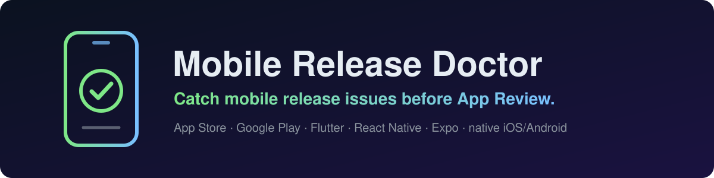
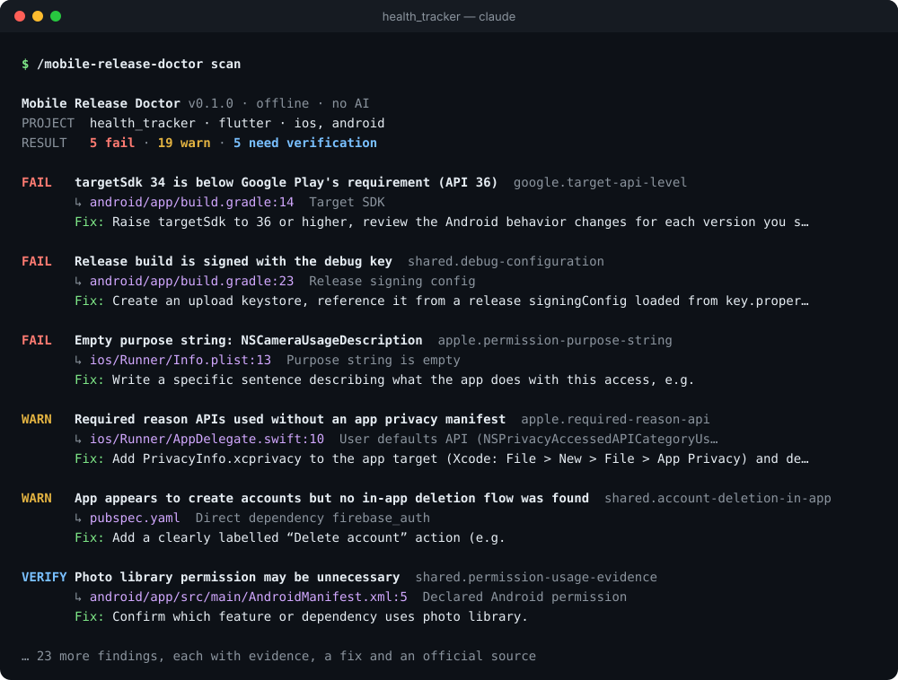
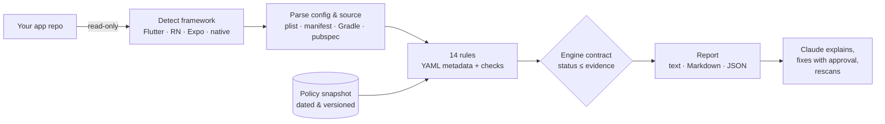

<div align="center">



<br>

[](https://github.com/lehongphuong/mobile-release-doctor/actions/workflows/ci.yml)
[](LICENSE)
[](#-install)
[](docs/ci.md)
[](SECURITY.md)
[](skills/mobile-release-doctor/references/rule-catalog.md)

**Your app got rejected again?** Scan it *before* you hit Submit.<br>
A local, read-only scanner + Claude Code skill that finds App Store and Google Play rejection risks in<br>
**Flutter · React Native · Expo · native iOS/Android** — with the file, the line, the fix and the official rule.

[**Quick start**](#-quick-start) · [**What it catches**](#-what-it-catches) · [**How it works**](#-how-it-works) · [**Rule catalog**](skills/mobile-release-doctor/references/rule-catalog.md) · [**Tiếng Việt**](#-tiếng-việt)

<br>



<sub>Real output for <a href="fixtures/flutter/risky-project"><code>fixtures/flutter/risky-project</code></a> · <a href="fixtures/expected/flutter-risky.md">full Markdown report</a></sub>

</div>

---

## 💡 Why

Every mobile dev knows the loop: build, upload, wait a day, get *"Guideline 5.1.1"*, google it, guess, resubmit, wait again. Most of those rejections are visible in the project **before** you upload — a vague purpose string, a debug-signed release, a `targetSdk` one year behind, a missing delete-account flow.

|  | Static checklist | **Mobile Release Doctor** |
|---|---|---|
| Reads your actual project | ❌ you cross-check by hand | ✅ `Info.plist`, `AndroidManifest`, Gradle, `pubspec`, Expo config, privacy manifest, source |
| Tells you *where* | ❌ | ✅ file + line + offending value |
| Up-to-date policy | ❌ goes stale silently | ✅ dated policy snapshot; warns when it is due for review |
| Honest about certainty | ❌ everything looks equally scary | ✅ `fail` / `warn` / `needs_review` — heuristics can never claim a violation |
| Fix and verify | ❌ | ✅ fix guidance + `--baseline` rescan shows what you resolved |
| Privacy | — | ✅ offline, read-only, never runs your code, redacts secrets |

> [!IMPORTANT]
> No tool can guarantee approval. Mobile Release Doctor reports what it can prove, flags what it suspects, and tells you plainly what a human must check. Exit code `0` means *"scan completed"*, never *"your app will pass"*.

## 🚀 Quick start

**In Claude Code** (recommended):

```bash
claude plugin marketplace add lehongphuong/mobile-release-doctor
claude plugin install mobile-release-doctor@mobile-release-doctor
```

Then, in your app's repo, just ask:

```text
/mobile-release-doctor:mobile-release-doctor scan
```

or in plain words — *"scan this app before I submit to both stores"*.

**Try it without installing anything** (Node.js 20+):

```bash
git clone https://github.com/lehongphuong/mobile-release-doctor
node mobile-release-doctor/skills/mobile-release-doctor/scripts/scan.mjs --project path/to/your/app
```

## 🩺 What it catches

<table>
<tr><td valign="top" width="50%">

### 🍎 App Store

- **Vague or empty purpose strings** — `"Allow camera access"` gets rejected under 5.1.1
- **Missing purpose strings** that a plugin needs (ITMS-90683)
- **Required reason APIs** without a privacy manifest, invalid reason codes, manifest not in the Xcode target (ITMS-91053)
- **`1.2.0-beta` versions** App Store Connect refuses
- **ATS disabled** for all domains

</td><td valign="top" width="50%">

### 🤖 Google Play

- **`targetSdk` below the requirement** in force on the scan date (API 36 since 2026-08-31)
- **Debug-signed or debuggable release builds**
- **`com.example` package names**
- **Restricted permissions** — background location, SMS/Call Log, all-files, `QUERY_ALL_PACKAGES`, photo/video, foreground services…
- **Web link for account deletion**

</td></tr>
<tr><td valign="top">

### 🔐 Privacy & accounts (both stores)

- **Sign-up without in-app account deletion**
- **Privacy policy missing / placeholder**, or silent about the analytics/ads SDKs you ship
- **Permissions with no matching feature**
- **Reviewer can't log in** — no demo account confirmed

</td><td valign="top">

### 🧹 Release hygiene

- **Hard-coded secrets**: private keys, cloud & payment keys, committed keystores and signing passwords (always redacted)
- **Template leftovers**: Flutter counter app, RN welcome screen, lorem ipsum, "Coming soon"
- **Version drift** between `pubspec.yaml`, Gradle and Info.plist

</td></tr>
</table>

Every finding includes **evidence → why it matters → how to fix → official source**. See the [rule catalog](skills/mobile-release-doctor/references/rule-catalog.md) for details and known limitations of each rule.

## 🤖 Works with Claude Code

The skill turns the scan into a conversation — Claude reads the JSON report, not your whole repo:

| You say | What happens |
|---|---|
| `scan` / *"check this before release"* | Runs the scanner, groups findings into **must fix**, **verify**, **manual review** |
| `scan --platform ios` | App Store checks only |
| *"explain google.account-deletion-web"* | Rule, evidence, source, fix |
| `fix` | Proposes patches, **edits only after you approve**, then rescans and shows what got resolved |
| `rejection` + paste Apple/Google's message | Maps the rejection to findings, fix plan, resubmit checklist, draft reply to App Review |
| `report` | Markdown report for your team or client |

## ⚙️ How it works



- **Deterministic core, AI on top.** Same project + same rule version ⇒ same report. No API key needed.
- **Evidence-gated statuses.** Each rule declares the statuses and max severity it may emit; the engine rejects anything above that.
- **Policy as data.** Deadlines and API levels live in [`policy-data.yaml`](skills/mobile-release-doctor/policy/policy-data.yaml) with sources and dates — not hard-coded.
- **Tested like a product.** Every rule has positive, negative and *unknown* tests; sample projects with expected reports; CI on Linux, macOS and Windows; [field-tested](docs/field-testing.md) on open-source apps.

## 📦 Install

<details open>
<summary><b>Claude Code plugin</b></summary>

```bash
claude plugin marketplace add lehongphuong/mobile-release-doctor
claude plugin install mobile-release-doctor@mobile-release-doctor
# uninstall
claude plugin uninstall mobile-release-doctor@mobile-release-doctor
```
</details>

<details>
<summary><b>Standalone skill</b> (copy one folder)</summary>

```bash
git clone https://github.com/lehongphuong/mobile-release-doctor
cp -r mobile-release-doctor/skills/mobile-release-doctor ~/.claude/skills/      # all projects
# or .claude/skills/ inside one project
```
Invoke with `/mobile-release-doctor`. Delete the folder to uninstall.
</details>

<details>
<summary><b>Without Claude (CLI / CI)</b></summary>

The scanner is a single dependency-free file.

```bash
node scan.mjs --project .                                   # terminal report
node scan.mjs --project . --format markdown --output report.md
node scan.mjs --project . --strict --fail-on high           # exit 1 on high-severity risks
node scan.mjs --project . --format json --baseline old.json # what did my fix resolve?
```

GitHub Actions example: [docs/ci.md](docs/ci.md) · all options and exit codes: [configuration](skills/mobile-release-doctor/references/configuration.md)
</details>

## 📝 Tell it what code can't

Some facts only you know. Add `.release-doctor.yml` and those `needs_review` items become real checks:

```yaml
app:
  has_account_creation: true
  account_deletion:
    in_app_path: "Settings > Account > Delete account"
    web_url: https://yourapp.com/delete-account
  privacy_policy_url: https://yourapp.com/privacy
  requires_login_for_review: true
  review_demo_account_provided: true
fail_on: high
ignore:
  - rule: shared.embedded-secrets
    path: lib/firebase_options.dart
    reason: Firebase client config is public by design   # a reason is required
```

## 🧪 Try the sample projects

```bash
git clone https://github.com/lehongphuong/mobile-release-doctor && cd mobile-release-doctor
node skills/mobile-release-doctor/scripts/scan.mjs --project fixtures/flutter/risky-project   # 5 fail
node skills/mobile-release-doctor/scripts/scan.mjs --project fixtures/flutter/clean-project   # 0 findings
```

[`fixtures/`](fixtures) has clean, risky and "not enough data" projects for every framework; [`fixtures/expected/`](fixtures/expected) holds the reports CI checks against.

## ❓ FAQ

<details>
<summary><b>Does it send my code anywhere?</b></summary>

No. It runs offline, never makes network requests, never executes your build or scripts, and never writes to your project. Secret values are masked in every report. See [SECURITY.md](SECURITY.md).
</details>

<details>
<summary><b>Do I need an AI API key?</b></summary>

No. The scanner is rule-based. Claude Code is the friendly interface; the CLI works on its own.
</details>

<details>
<summary><b>Will it tell me my app will be approved?</b></summary>

Never. It catches what is visible in the project. Store metadata, screenshots, runtime behavior and reviewer judgement are out of reach — the report says so explicitly instead of giving you a misleading score.
</details>

<details>
<summary><b>Which frameworks are covered best?</b></summary>

Flutter has the deepest coverage (plugin → permission mapping, pubspec versioning, template detection). React Native, Expo and native projects are detected and get every rule that reads native config. See [supported checks](docs/supported-checks.md).
</details>

<details>
<summary><b>It flagged something that's fine. What now?</b></summary>

Accept it in `.release-doctor.yml` with a reason, and please [report the false positive](https://github.com/lehongphuong/mobile-release-doctor/issues/new?template=false-positive.yml) with a minimal snippet — no private code needed.
</details>

## 🗺️ Roadmap

- [x] 14 evidence-based rules · Flutter, RN, Expo, native detection · text/Markdown/JSON · baseline rescan
- [ ] Structured rejection-message parser
- [ ] Merged-manifest support & SDK advisory snapshot
- [ ] Metadata / ASO checks from fastlane metadata
- [ ] HTML report for agencies

Full list: [docs/roadmap.md](docs/roadmap.md).

## 🤝 Contributing

The most valuable contributions are **real rejection cases** and **new rules backed by official sources**. Adding a rule is three files — YAML metadata, a check, and positive/negative/unknown tests. Start with [CONTRIBUTING.md](CONTRIBUTING.md) and [docs/architecture.md](docs/architecture.md).

[🐞 Report a false positive](https://github.com/lehongphuong/mobile-release-doctor/issues/new?template=false-positive.yml) · [📮 Share a rejection case](https://github.com/lehongphuong/mobile-release-doctor/issues/new?template=rejection-case.yml)

## 🇻🇳 Tiếng Việt

**Mobile Release Doctor** quét dự án Flutter, React Native, Expo và iOS/Android native **ngay trên máy bạn** để tìm những lỗi hay khiến app bị Apple/Google từ chối: purpose string mơ hồ, ký release bằng debug key, `targetSdk` cũ, thiếu luồng xóa tài khoản, lộ secret… Mỗi lỗi kèm **file, dòng, cách sửa và link quy định chính thức**. Không cần API key, không gửi code đi đâu, không tự sửa file khi bạn chưa đồng ý.

```bash
claude plugin marketplace add lehongphuong/mobile-release-doctor
claude plugin install mobile-release-doctor@mobile-release-doctor
```

Rồi trong Claude Code: *"scan app này trước khi submit"* hoặc dán nguyên văn thư từ chối của Apple/Google để được phân tích và lập kế hoạch sửa.

---

<div align="center">

**If Mobile Release Doctor saved you one rejection, a ⭐ helps other devs find it.**

[](https://github.com/lehongphuong/mobile-release-doctor/stargazers)

<sub>MIT licensed · Not affiliated with Apple or Google · App Store and Google Play are trademarks of their respective owners</sub>

</div>
